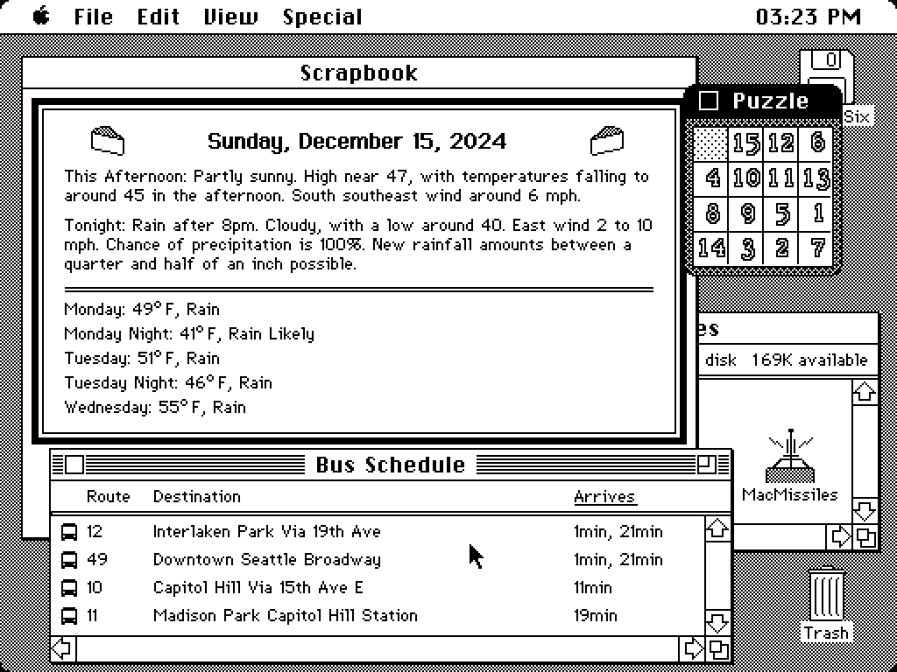
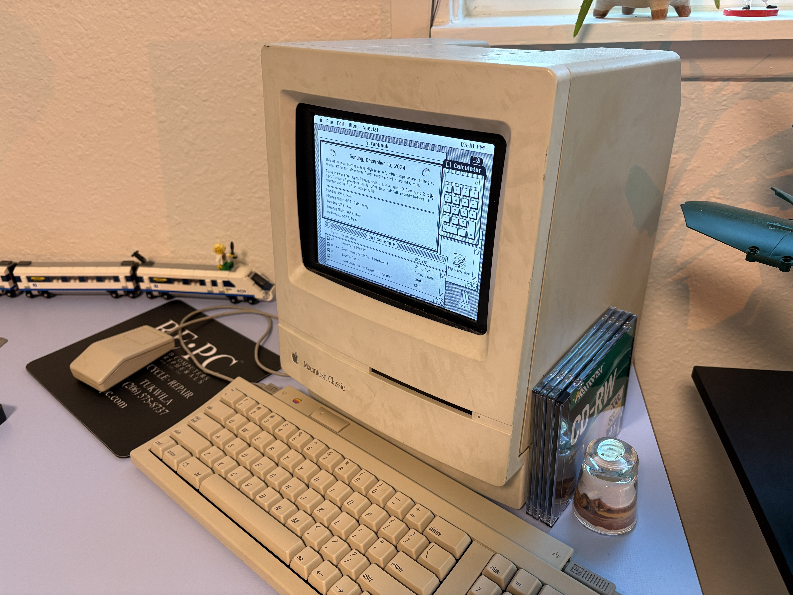

<p align="center">

</p>

This project is a fork of [the original SystemSix](https://github.com/EngineersNeedArt/SystemSix), made by EngineersNeedArt. SystemSix is a "desk accessory" running on a Raspberry Pi. This project differs from the main repository in that it is intended to be run on an LCD display that can handle diplaying images at a resolution of 512 x 384. It also allows you to swap out the calendar list display with bus arrival times for your nearby bus stops using the OneBusAway API.

<p align="center">

</p>

### Features

• Calendar date is displayed.

• Retrieves and displays your first four calendar events for the day, refreshes in the evening.

• Optionally replace calendar list with a list of live bus arrival times using the OneBusAway API. You must provide your own API key.

• Optionally enable object detection with an IR sensor to automatically turn on the screen when an obstacle is detected.

• Retrieves and displays the local weather forecast at the start of each day.

• Current phase of the moon displayed. (New moon? Maybe you get a Calculator instead.)

• Specify "trash day" and on that day of the week, the trash can icon will display full. Can be a handy reminder.

• Several different overall layouts and a random selection from over 100 classic icons means you wake up to a surprise desktop every day.

<p align="center">

</p>

I have my computer running on a 8" 1024 x 768 display, mounted using a 3D-printed mount I found on Thingiverse. My Pi is running Raspberry Pi OS, and is set to automatically run the `run_systemsix.sh` script upon login.


### Running

In order to install & run SystemSix at boot on your Raspberry Pi or other computer, follow these steps, either directly on the machine or via SSH:

1. Set up your locale: `sudo dpkg-reconfigure locales`. You must select the locale which matches your `LOCALE` in settings.py, for instance "en_US.UTF-8" for USA.
2. Install the required dependencies through `apt`: `sudo apt install feh libjpeg-dev zlib1g-dev libfreetype6-dev -y`
3. Set up the Python virtual environment: `python -m venv venv && source venv/bin/activate`.
4. Install the required Python packages via pip.
    1. Update pip itself: `python3 -m pip install --upgrade pip`.
    2. Install dateutil: `pip install python-dateutil --upgrade`.
    3. Install other packages which don't require special installation steps: `pip install icalevents lxml numpy requests schedule vobject onebusaway RPi.GPIO`.
    4. Install Python Image Library: `python -m pip install --force-reinstall --upgrade --no-cache-dir pillow==9.5.0`. This one gave me the most headache, if it gives you issues try looking around on the internet for help.
5. Configure your desktop envrionment to boot up SystemSix automatically after logging into the desktop environment.
    1. Determine which desktop envionment you are running: `pgrep -l 'labwc|wayfire|Xorg'`.
    2. If `wayfire`:
        1. Create an autostart config: `nano ~/.config/wayfire.ini`.
        2. In the file, type in the following, each on a separate line:
            1. `[autostart]`
            2. `systemsix=/home/pi/SystemSix/run_systemsix.sh`
            3. `dpms_timeout=300` This block configures the screen to turn off after 300 seconds (5 minutes), feel free to change as desired.
    3. If `labwc`: 
        1. Create an autostart config: `nano ~/.config/labwc/autostart`.
        2. In the file, type in: `/home/jake/SystemSix/run_systemsix.sh &`. The & at the end ensures that the script runs in the background.
    4. This says that after logging in, the computer will run the shell script named `run_systemsix.sh` located at the path `/home/pi/SystemSix/`. Replace the user `pi` with your username if yours differs. If you pulled the files down somewhere else you will have a different path to the shell script file.

You can then run SystemSix automatically after rebooting your machine, or manually by running the `run_systemsix.sh` script. If you want to quit to the Desktop while SystemSix is displaying the image, simply click Q or Escape on your keyboard.

If the Rasperry Pi taskbar is still showing when `feh` is displaying the image, you can configure it to autohide by adding two lines to `~/.config/wf-panel-pi.ini`:

```
autohide=true
autohide_duration=500
```

BEWARE: The e-ink display functionality might be broken in this fork. In `systemsix.py`, there is a flag at the top: `USE_EINK_DISPLAY`. Set this to `False` and you can run `systemsix.py` in any environment, even without an e-ink display attached. The workflow for updating the e-ink display involves first creating the image that you want displayed. Most of the code in SystemSix is doing just that: creating the final image of the desktop. When you set `USE_EINK_DISPLAY` to `False` the final image is instead opened in your current OS environment, not sent to the e-ink driver. (On MacOS it is Preview that is launched to display the resulting image.)

### Settings

"Trash day" is defined in `Settings.py` as an integer. Set the value to `1` for Monday, `2` for Tuesday, etc. Setting the value to `None` will cause the trash to never be shown full. Set to any other value to indicate that "trash day" should be random.

For the weather API I use, `LATITUDE` and `LONGITUDE` should be supplied in `Settings.py`. I query [api.weather.gov](api.weather.gov) to turn the LAT/LONG into an office ID and grid X and Y that weather.gov uses to retrieve local forecasts.

To display your upcoming calendar events the settings and code are the same as the implementation from 13Bytes. I can only speak to my experiences with MacOS Calendar. `WEBDAV_IS_APPLE` I set to `True` and for `WEBDAV_CALENDAR_URL` I entered the URL to fetch my public calendar.

Figuring out my calendar URL turned out to be a challenge. In the end I had to create a new calendar in Apple's Calendar app and make sure to mark it as *public*. Then I found the sharing affordance in Calendar and "shared" the calendar with myself (I emailed it to myself). The link in the email contained the (150+ character) URL that I was then able to paste into `Settings.py`. Mine started out like this: `webcal://p97-caldav.icloud.com/published/2/NDYyNT....`.

`REFRESH_SECONDS` determines how often SystemSix generates a new image. This is particularly userful for updating bus arrival times. If you don't want to display bus information, setting this value to ~4 hours should suffice.

If you'd rather display bus arrival times in [supported regions](https://onebusaway.org/onebusaway-deployments/) using OneBusAway, you must set `REPLACE_CALENDAR_WITH_BUS_SCHEDULE` to `True` and provide an API key. You can then supply any number of bus stop IDs in the `ONEBUSAWAY_STOP_IDS` list.

If you have an Infrared sensor plugged into your Pi's GPIO pins, then enable `DETECT_OBJECTS`. This turns on the screen when an obstacle is detected. You may need to change the numbers for your VCC and output pins if yours are plugged into different headers.
